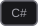
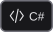
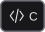
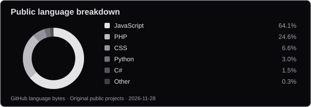
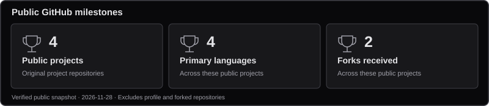

  

## About Me

I'm a software developer and undergraduate researcher at the Federal Institute of Ceará (IFCE), interested in artificial intelligence, computer vision and computer networks.

My work combines software engineering with experimental research, from multi-object tracking and network traffic analysis to efficient intelligent systems and practical software tools.

  
  
  

  

Reduced-motion alternatives: <a href="assets/headers/obsidian-header-static.svg">profile header</a> · <a href="assets/animations/neural-network-static.svg">neural network</a>.

---

## Research & Featured Projects

<table>
  <tr>
    <td width="50%" valign="top">
      <h3> Multi-Object Tracking Research</h3>
      
Computer Vision · Research

      

      
Comparative evaluation of multi-object tracking methods.

      
  

      
Public documentation pending

    </td>
    <td width="50%" valign="top">
      <h3> SDN Traffic Research</h3>
      
Computer Networks · Research

      

      
Machine learning for network traffic classification.

      
  

      
Public documentation pending

    </td>
  </tr>
  <tr>
    <td width="50%" valign="top">
      <h3> PSR-Tracker</h3>
      
Computer Vision · Experimental

      

      
Experimental multi-object tracking method based on radial spatial relationships and motion.

      
 

      
<a href="https://github.com/OfMuriloSM/PSR-Tracker">View repository</a>

    </td>
    <td width="50%" valign="top">
      <h3> Satomi</h3>
      
Artificial Intelligence · Software

      

      
Modular, local-first personal AI assistant.

      
  

      
Public showcase pending

    </td>
  </tr>
  <tr>
    <td width="50%" valign="top">
      <h3> SSTPDF</h3>
      
Scientific Tools · Software

      

      
Scientific document translation tool with a focus on layout preservation.

      
 

      
Public showcase pending

    </td>
    <td width="50%" valign="top">
      <h3> PUFO</h3>
      
Windows · Software

      

      
Modular desktop overlay inspired by the Dynamic Island interaction model.

      
  

      
<a href="https://github.com/OfMuriloSM/PUFO">View repository</a>

    </td>
  </tr>
</table>

---

## Technology Stack

### Languages

  
  
  
  
  
  

### Frameworks & AI

  
  
  
  
  
  

### Tools & Data

  
  
  
  
  
  

---

## GitHub Analytics

  
  

Monochrome language breakdown — public original projects

  

The monochrome chart uses public original project code sizes after its first successful refresh. The existing Top Languages service remains available above.

  

  

  

  

Language statistics reflect repository code, not proficiency. Public milestones are a dated snapshot of original public projects, refreshed by the portfolio workflow. Profile views are an approximate image-request counter, not unique visitors.

---

## Contact & Links

  
  
  
  
  
  

---

  

