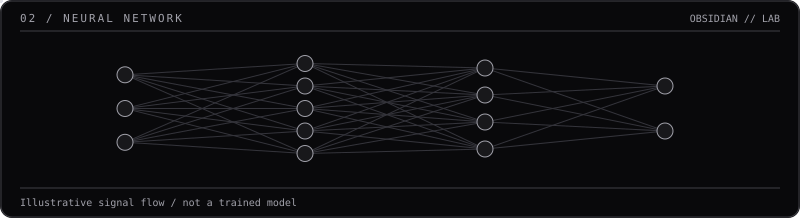

  

## About Me

I'm a software developer and undergraduate researcher at the Federal Institute of Ceará (IFCE), interested in artificial intelligence, computer vision and computer networks.

My work combines software engineering with experimental research, from multi-object tracking and network traffic analysis to efficient intelligent systems and practical software tools.

**Artificial Intelligence · Computer Vision · Computer Networks**

  

---

## Research & Featured Projects

<table>
  <tr>
    <td width="50%" valign="top">
      <h3>Multi-Object Tracking Research</h3>
      
Computer Vision · Research · Research

      
Comparative evaluation of multi-object tracking methods.

      
Public documentation pending

    </td>
    <td width="50%" valign="top">
      <h3>SDN Traffic Research</h3>
      
Computer Networks · Research · Research

      
Machine learning for network traffic classification.

      
Public documentation pending

    </td>
  </tr>
  <tr>
    <td width="50%" valign="top">
      <h3>PSR-Tracker</h3>
      
Computer Vision · Experimental · Alpha

      
Experimental multi-object tracking method based on radial spatial relationships and motion.

      
<a href="https://github.com/OfMuriloSM/PSR-Tracker">View repository</a>

    </td>
    <td width="50%" valign="top">
      <h3>Satomi</h3>
      
Artificial Intelligence · Software · Alpha

      
Modular, local-first personal AI assistant.

      
Public showcase pending

    </td>
  </tr>
  <tr>
    <td width="50%" valign="top">
      <h3>SSTPDF</h3>
      
Scientific Tools · Software · Beta

      
Scientific document translation tool with a focus on layout preservation.

      
Public showcase pending

    </td>
    <td width="50%" valign="top">
      <h3>PUFO</h3>
      
Windows · Software · Alpha

      
Modular desktop overlay inspired by the Dynamic Island interaction model.

      
<a href="https://github.com/OfMuriloSM/PUFO">View repository</a>

    </td>
  </tr>
</table>

---

## Technology Stack

  
  
  
  
  
  
  
  
  
  
  
  
  
  

---

## GitHub Analytics

   

---

## Contact & Links

  
  
  
  
  

---

<picture>
  <source media="(prefers-color-scheme: dark)" srcset="https://raw.githubusercontent.com/OfMuriloSM/OfMuriloSM/output/pacman-contribution-graph-dark.svg">
  <source media="(prefers-color-scheme: light)" srcset="https://raw.githubusercontent.com/OfMuriloSM/OfMuriloSM/output/pacman-contribution-graph.svg">
  
</picture>
