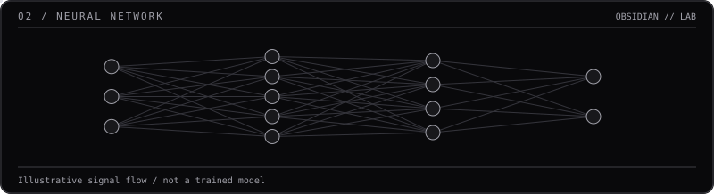

# Obsidian — Asset Review

Approved visual direction for the 2027 profile reconstruction.

## Profile header

  

## Neural network

  

## Asset inventory

| Asset | Purpose |
| --- | --- |
| `branding/sws-wolf.png` | Original wolf emblem embedded in the approved header |
| `headers/obsidian-header-v2.svg` | Approved animated header, with embedded logo |
| `animations/neural-network.svg` | Selected illustrative neural network animation |

The header and neural network use declarative SVG animation. They are self-contained; no JavaScript is required. Rendering in GitHub's image viewer and README must be checked visually. The existing Pac-Man workflow and output branch remain unchanged.

This page is a staging review, not the final profile README.
